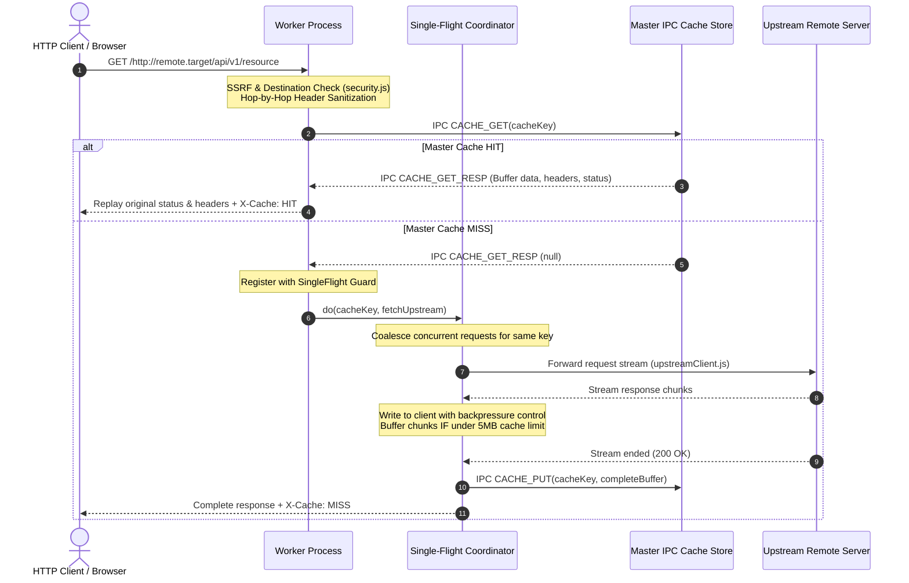

# System Architecture & Technical Specifications

**System:** Multithreaded Proxy Web Server with LRU Cache  
**Runtime:** Node.js v22+  
**Architecture Pattern:** Clustered Process Supervisor with Authoritative IPC Centralized Cache  

---

## 1. High-Level System Architecture

The server employs a resilient multi-process architecture using the Node.js `cluster` module. A master supervisor process oversees worker lifecycle, coordinates an authoritative dual-bounded LRU cache, and serves health/telemetry metrics, while worker processes handle incoming network traffic independently.

```
                                  +-------------------------------------------------------------+
                                  |                 Master Process (Supervisor)                 |
                                  |  - Process Supervisor & Crash Resiliency Loop               |
                                  |  - Authoritative Dual-Bounded LRU Cache (Memory-Aware)     |
                                  |  - IPC Cache Protocol Dispatcher (GET/PUT/DEL/STATS)        |
                                  |  - Port 8081: /api/workers-status Telemetry Server          |
                                  +-------------------------------------------------------------+
                                                 /              |              \
                                     IPC Channel/               |               \IPC Channel
                                               v                v                v
                       +-------------------------------+ +-------------------------------+
                       |        Worker Process 1       | |        Worker Process N       |
                       | - Port 8080 (OS load balanced)| | - Port 8080 (OS load balanced)|
                       | - Single-Flight Stampede Guard| | - Single-Flight Stampede Guard|
                       | - SSRF & Destination Validator| | - SSRF & Destination Validator|
                       | - Bounded Stream Forwarder    | | - Bounded Stream Forwarder    |
                       | - Dashboard & REST Router     | | - Dashboard & REST Router     |
                       +-------------------------------+ +-------------------------------+
```

---

## 2. Request Lifecycle & Data Flow



---

## 3. Core Architectural Modules

### 3.1 `workerManager.js` (Master Process Supervisor)
- **Lifecycle Management:** Spawns `WORKER_COUNT` workers (defaulting to available CPU cores via `os.cpus().length`).
- **Crash Detection & Circuit Breaker:** Listens for `cluster.on('exit')`. If rapid crashes exceed threshold (5 crashes within 15 seconds), worker restarts pause with backoff to prevent fork bombs.
- **IPC Protocol Dispatcher:** Answers worker queries for `CACHE_GET`, `CACHE_PUT`, `CACHE_DELETE`, `CACHE_CLEAR`, and `CACHE_STATS`.
- **Graceful Shutdown:** Intercepts `SIGINT`/`SIGTERM`, sends `SHUTDOWN` messages to workers, allows in-flight socket draining, and cleanly exits.

### 3.2 `lruCache.js` (Dual-Bounded LRU Cache)
- **Time Complexity:** $O(1)$ lookup, insertion, update, and eviction using a `Map` combined with a doubly linked list.
- **Dual Limits:**
  - `maxEntries`: Maximum number of entries (default: 50).
  - `maxBytes`: Maximum cumulative memory budget (default: 100 MiB).
  - `maxItemBytes`: Maximum size for any single item (default: 5 MiB).
- **Eviction Strategy:** Evicts least-recently-used items from the tail until both item count and memory footprint satisfy the configured budget.

### 3.3 `singleFlight.js` (Stampede / Thundering Herd Guard)
- Coalesces concurrent in-flight requests for identical cache keys across the worker.
- The first request triggers the upstream network dispatch; subsequent concurrent callers subscribe to the in-flight promise and receive the identical payload once completed.

### 3.4 `upstreamClient.js` (Streaming & Backpressure Engine)
- **Zero Memory Bloat:** Streams upstream data directly into the client HTTP response via event-driven write-drain listeners (`clientRes.write(chunk)` with `upstreamRes.pause()` / `clientRes.once('drain')`).
- **Bounded Buffering:** Collects response chunks into an array only while total length $\le$ `MAX_ITEM_BYTES`. If the response exceeds this limit, buffer memory is immediately released while the client stream continues uninterupted.
- **Client Cancellation:** Aborts upstream connections immediately if the client disconnects before stream completion.

### 3.5 `security.js` (SSRF & Access Control)
- **DNS Resolution & IP Validation:** Resolves domain names and inspects all returned records. Prohibits RFC 1918 private subnets, loopback addresses (`127.0.0.0/8`, `::1`), link-local/cloud-metadata (`169.254.169.254`, `fe80::/10`), and unique-local IPv6 addresses (`fc00::/7`).
- **Hop-by-Hop Header Stripping:** Cleans connection-specific headers per RFC 7230.
- **Rate Limiting:** Sliding-window rate limiting per client IP address.

---

## 4. Telemetry & Administrative Endpoints

- `GET /api/cache-status`: Returns consolidated metrics (cache size, total bytes, memory in MB, hit ratio, hit/miss counters, and ordered LRU key metadata).
- `POST /api/clear-cache`: Authoritatively purges the centralized cache across all cluster processes.
- `GET /api/cache-item?key=...`: Inspects individual cache entry metadata.
- `DELETE /api/cache-item?key=...`: Evicts a specific key from the authoritative cache.
- `GET /api/workers-status` (Port 8081): Real-time process metrics (worker PID, status, active requests, restarts).

