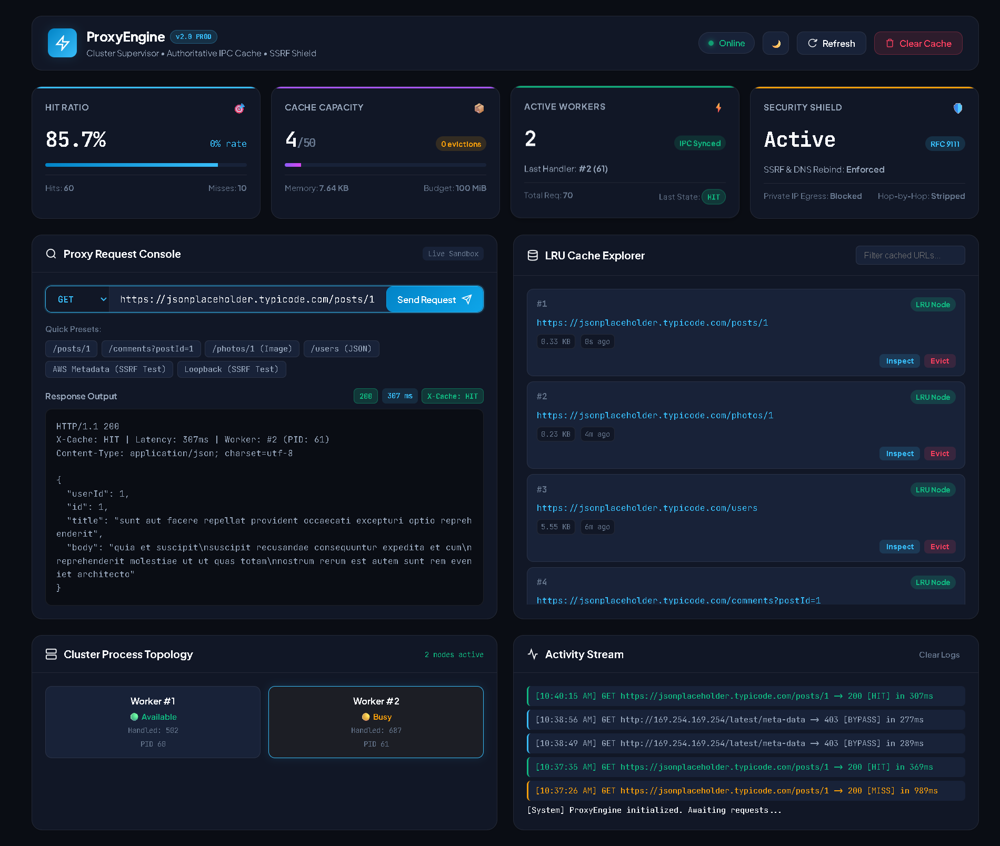
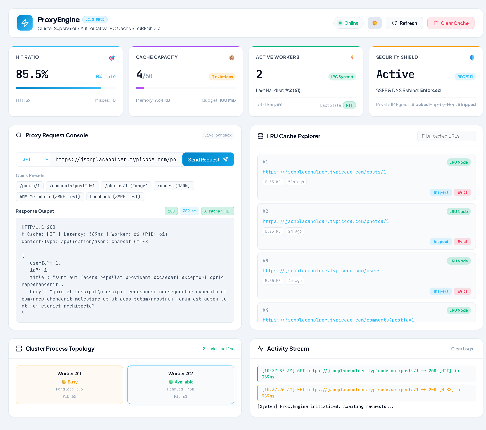
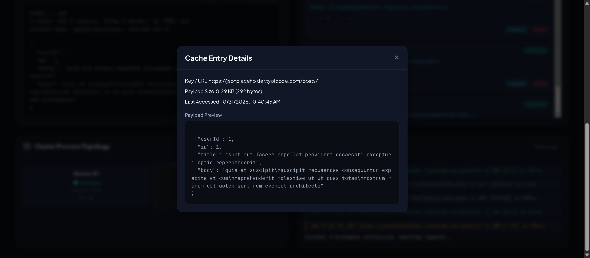
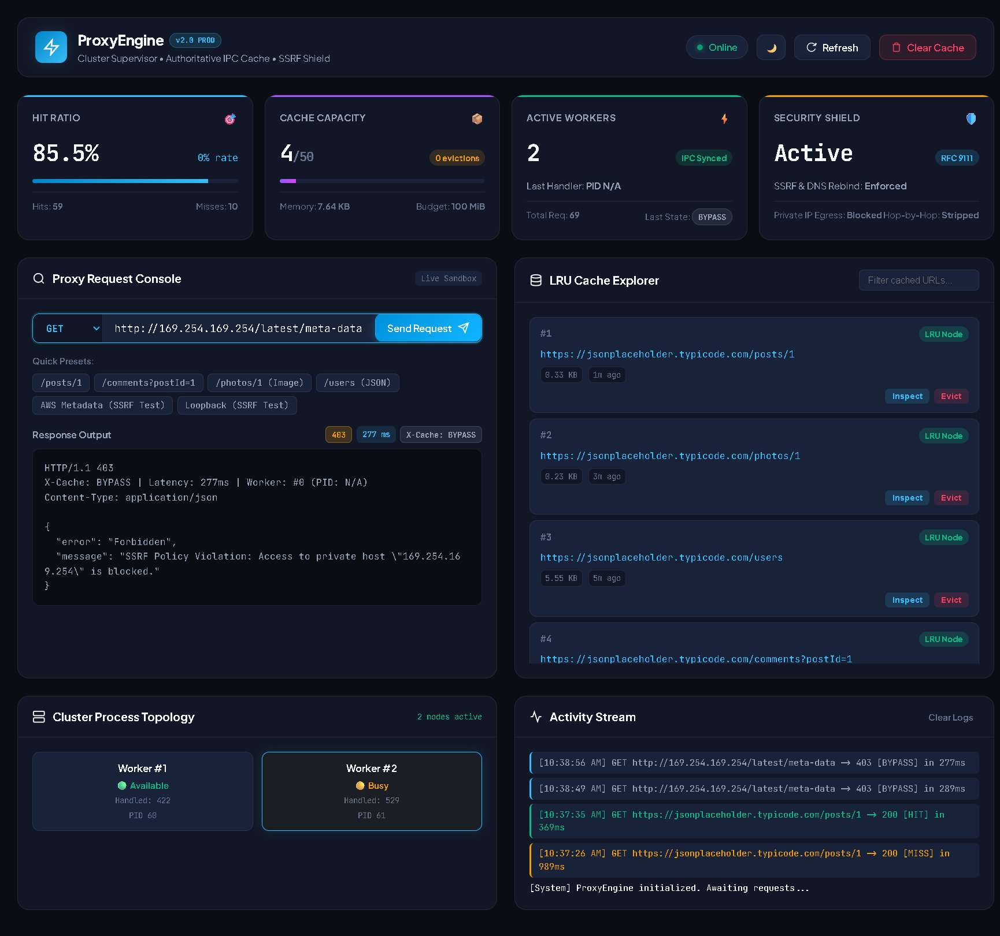
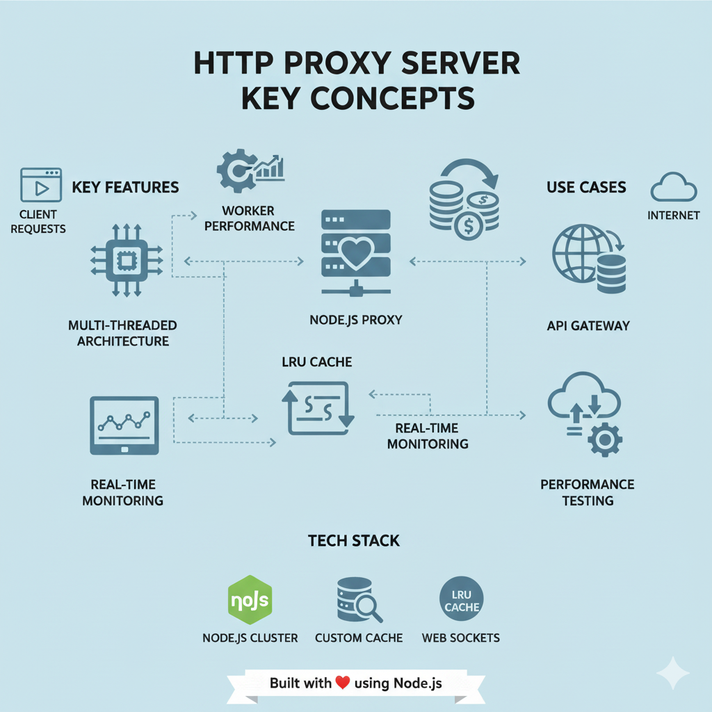

# Multithreaded Proxy Web Server with LRU Cache

[](https://multithreaded-lru-proxy.onrender.com)
[](https://nodejs.org)
[](LICENSE)
[](test/)

A high-concurrency, security-hardened, production-grade HTTP/HTTPS reverse and forward proxy server built with Node.js. Powered by dual concurrency engines (multi-process clustering and true zero-copy multithreading via `SharedArrayBuffer` & `Atomics`), single-flight stampede protection, dual-bounded memory management, SSRF defense, streaming with backpressure control, and a real-time developer monitoring console.

---

## 🌐 Live Cloud Deployment

The application is deployed live on Render and accessible worldwide:

- **Live Dashboard & Proxy Console:** [https://multithreaded-lru-proxy.onrender.com](https://multithreaded-lru-proxy.onrender.com)
- **Live Worker Status Telemetry:** [https://multithreaded-lru-proxy.onrender.com/api/workers-status](https://multithreaded-lru-proxy.onrender.com/api/workers-status)
- **Live Authoritative Cache Status:** [https://multithreaded-lru-proxy.onrender.com/api/cache-status](https://multithreaded-lru-proxy.onrender.com/api/cache-status)

---

## 📸 Production Screenshots

### 1. Modern Dark Theme Console (Default)
Real-time KPI telemetry meters, active worker cluster topology, interactive proxy test sandbox with millisecond latency timing, and searchable LRU cache list.


### 2. Sleek Light Theme
Full UI theme toggle with preference saved in `localStorage`.


### 3. Authoritative Cache Node Inspector Modal
Deep payload inspection displaying byte sizes, last accessed timestamps, cache headers, and raw response body.


### 4. Live SSRF & DNS Rebinding Shield
Automatic detection and blocking of internal loopbacks, private RFC 1918 subnets, and AWS/GCP cloud metadata endpoints with HTTP 403 Forbidden.


---

## 🧵 Dual Concurrency Engines (Clustering & True Multithreading)

This project supports two enterprise concurrency architectures:

### Engine 1: Multi-Process Cluster (`npm start`)
- Uses Node.js `node:cluster` to run isolated worker processes across CPU cores.
- Features an authoritative master cache coordinated via non-blocking IPC pipes.
- Maximum fault tolerance: if a worker crashes, other workers continue handling traffic without interruption.

### Engine 2: True Multithreaded Shared-Memory Engine (`npm run start:threads`)
- Uses Node.js `node:worker_threads` and **`SharedArrayBuffer` with `Atomics`** (Approach 2).
- **Zero-Copy Shared Cache:** All OS threads share the exact same physical heap memory pool without IPC serialization or socket overhead.
- **Atomic Mutex Synchronization:** Critical sections are synchronized via `Atomics.compareExchange`, `Atomics.wait`, and `Atomics.notify`.
- **CPU Offloading Thread Pool:** Offloads Brotli/Gzip compression, payload parsing, and cryptographic hashing across worker threads without blocking the event loop.

---

## 🚀 Key Architectural Highlights

- **Zero-Copy SharedMemoryLRU (`sharedMemoryLRU.js`):** Binary data arena with descriptor tables and FNV-1a 32-bit hash indexing for sub-microsecond cache lookups in shared RAM.
- **Authoritative Central Master Cache over IPC:** Eliminates worker cache split-brain in clustered mode.
- **Dual-Bounded Memory & Count Eviction:** Bounded by both maximum entry count (`CACHE_LIMIT`) and total byte consumption (`MAX_CACHE_BYTES`). Large payloads exceeding `MAX_ITEM_BYTES` (5 MiB) automatically bypass caching to prevent cache exhaustion.
- **Single-Flight Request Coalescing:** Eliminates cache stampedes (thundering herd). Concurrent requests for identical uncached URLs coalesce onto a single upstream network call.
- **SSRF Defense Shield:** DNS pre-resolution and validation blocks private IP ranges (RFC 1918, RFC 3927 link-local, RFC 4193 IPv6 ULA, cloud metadata `169.254.169.254`, and loopback).
- **Zero-Corruption Streaming Pipeline:** True binary-safe Node.js streams preserve exact byte lengths, gzip/brotli compression payloads, and image/media data with backpressure control.
- **Worker Crash Resilience:** Automatic supervision loop detects worker crashes and restarts failed workers with exponential backoff and circuit-breaking.
- **Single-Port Cloud Deployment Ready:** Dual-mode telemetry serves worker status via standard `/api/workers-status` on the primary HTTP port (compatible with Render, Railway, Heroku) as well as a dedicated internal telemetry port.
- **XSS-Hardened Modern Dashboard:** Responsive UI with Dark/Light theme toggle, interactive proxy testing sandbox, real-time KPI metrics, and LRU cache explorer built using native DOM construction with `textContent` and event listeners.

---

## 💡 Real-World Use Cases

1. **High-Performance API Acceleration & Cost Reduction:**
   Point client applications or frontend microservices through this proxy (`/https://api.example.com/data`). Repetitive downstream queries are served directly from the authoritative in-memory LRU cache ($O(1)$ lookups) with sub-millisecond latencies, significantly reducing upstream API billing costs and avoiding provider rate limits.
2. **Microservice Egress & Load Distribution:**
   Serves as an intelligent reverse/forward proxy gateway distributing traffic evenly across CPU cores via Node.js cluster processes or worker threads without cache divergence.
3. **Thundering Herd / Stampede Elimination:**
   When high traffic hits an uncached or freshly expired endpoint, the built-in single-flight engine guarantees only a single request touches the upstream origin.
4. **Hardened Egress Gateway (SSRF Shield):**
   Prevents malicious external users from abusing open proxy inputs to scan cloud provider instance metadata (`169.254.169.254`), internal Kubernetes services, or internal microservices.
5. **Real-Time Traffic Observability:**
   Developers can inspect live proxy requests, examine exact headers, measure origin latency, and manually evict or inspect cached nodes directly from the web console.

---

## 📐 System Architecture & Flowcharts

### 1. Functional System Flowchart


### 2. Shared-Memory Multithreading Architecture (Approach 2)
```
+-----------------------------------------------------------------------------------+
|                           Single Process Address Space                            |
|                                                                                   |
|   +-----------------------+     +-----------------------+                         |
|   |    Worker Thread 1    | ... |    Worker Thread N    |                         |
|   |  - HTTP Request Flow  |     |  - HTTP Request Flow  |                         |
|   |  - CPU Brotli/Crypto  |     |  - CPU Brotli/Crypto  |                         |
|   +-----------------------+     +-----------------------+                         |
|               \                             /                                     |
|                \                           /                                      |
|    Atomics.wait \                         / Atomics.notify                        |
|                  v                       v                                        |
|   +---------------------------------------------------------------------------+   |
|   |                    SharedArrayBuffer (Binary Heap RAM)                    |   |
|   |  - Header: Mutex Lock, Capacity, Size, LRU Head, LRU Tail, Stats Metrics   |   |
|   |  - Descriptors: 64-byte Slot Descriptors with FNV-1a Hash Indexing        |   |
|   |  - Arena: Zero-Copy Binary Storage for Keys, Headers, and Response Bodies|   |
|   +---------------------------------------------------------------------------+   |
+-----------------------------------------------------------------------------------+
```

For complete technical diagrams and data flow specifications, see [ARCHITECTURE.md](ARCHITECTURE.md).  
For the detailed threat model and defensive controls, see [SECURITY.md](SECURITY.md).  
For benchmarks and algorithmic complexity tables, see [PERFORMANCE.md](PERFORMANCE.md).  

---

## ⚙️ Configuration (`config.js`)

All parameters support environment variable overrides:

| Variable | Default | Description |
| :--- | :--- | :--- |
| `PORT` | `8080` | Proxy server & dashboard HTTP port (auto-mapped on Render) |
| `STATUS_PORT` | `8081` | Master worker status telemetry port |
| `CACHE_LIMIT` | `50` | Maximum number of items in LRU cache |
| `MAX_CACHE_BYTES` | `104857600` | Maximum cumulative cache memory budget (100 MiB) |
| `MAX_ITEM_BYTES` | `5242880` | Maximum individual cache item size (5 MiB) |
| `UPSTREAM_TIMEOUT_MS` | `15000` | Upstream connection timeout (15 seconds) |
| `WORKER_COUNT` | `0` | Number of workers/threads (0 = all CPU cores) |
| `ALLOW_PRIVATE_IP` | `false` | When true, permits connections to loopback/private IPs (used in tests) |

---

## 🏁 Quick Start

### 1. Installation
```bash
git clone https://github.com/Ramanand-tomar/Multithreaded-Proxy-web-server-with-LRU-cache.git
cd "Multihtreaded Server With LRU cache"
npm install
```

### 2. Run Automated Test Suite
Zero external testing dependencies — uses Node.js native test runner:
```bash
npm test
```

### 3. Start the Server Locally

```bash
# Engine 1: Clustered Multi-Process Mode (Production Default)
npm start

# Engine 2: True Multithreaded Shared-Memory Engine (Approach 2)
npm run start:threads

# Development mode (with auto-reload)
npm run dev
```

### 4. Open the Web Dashboard
Navigate to `http://localhost:8080/` or `http://localhost:8080/dashboard`.

---

## 📡 API Endpoints & Usage

### 1. Proxy An Upstream Resource
```bash
# Proxy an external HTTP/HTTPS resource
curl -i https://multithreaded-lru-proxy.onrender.com/https://jsonplaceholder.typicode.com/posts/1

# Response headers indicate cache hit/miss and worker PID
# X-Cache: HIT | MISS | BYPASS
# X-Worker-PID: 61
# X-Cache-Size: 4
# X-Cache-Hits: 59
# X-Cache-Misses: 10
```

### 2. Administrative REST APIs
- `GET /api/cache-status` — Returns authoritative cache statistics (hit ratio, memory in MB, keys).
- `POST /api/clear-cache` — Purges the centralized cache across all cluster processes.
- `GET /api/cache-item?key=<URL>` — Inspects individual cache entry metadata.
- `DELETE /api/cache-item?key=<URL>` — Evicts a specific key from the cache.
- `GET /api/workers-status` — Returns worker process status, PID, and request counters.

---

## 🧪 Automated Test Coverage

```
TAP version 13
✔ Streaming Backpressure & Bounded Buffering Integration Tests (2 tests)
✔ HTTP Proxy & Caching Integration Tests (5 tests)
✔ HTTP Utilities & Standards Compliance (3 tests)
✔ LRU Cache Implementation (6 tests)
✔ LRU Cache Byte-Aware Eviction & Limits (2 tests)
✔ Multithreaded Concurrent Execution with worker_threads & SharedArrayBuffer (1 test)
✔ Security Hardening & SSRF Protection (10 tests)
✔ Shared-Memory LRU Cache with SharedArrayBuffer & Atomics (5 tests)
✔ SingleFlight Request Coalescing (2 tests)
✔ ThreadPool with SharedMemoryLRU and Offloaded Worker Tasks (1 test)

37 tests passed, 0 failures.
```

---

## 📄 License

This project is licensed under the [MIT License](LICENSE).
